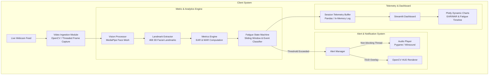
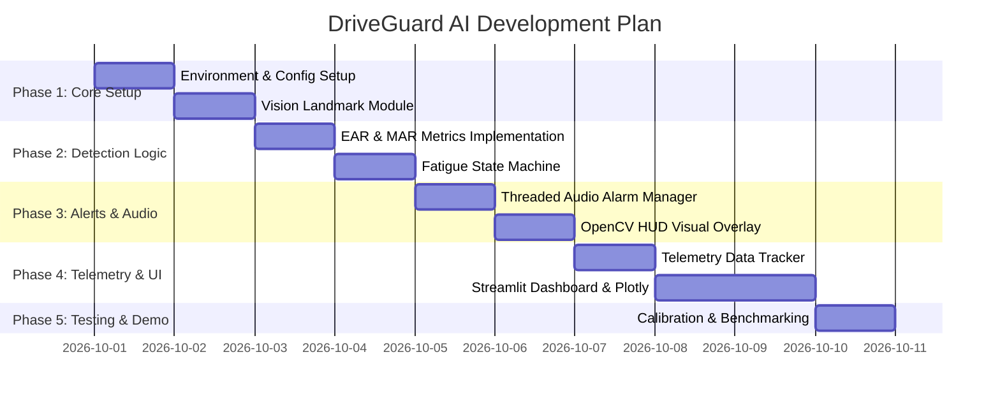

# DriveGuard AI - Technical Architecture & Specification

## 1. Overview & System Architecture

DriveGuard AI is a low-latency, real-time vision-based fatigue and drowsiness detection application designed for driver safety. The application processes live webcam streams locally using MediaPipe Face Mesh, computes geometric eye and mouth facial metrics continuously, updates a real-time driver state machine, triggers non-blocking audio-visual alerts upon detecting critical fatigue, and renders an interactive telemetry dashboard using Streamlit and Plotly.

### High-Level System Architecture



---

## 2. Module Breakdown

```
driveguard-ai/
├── config.py                 # Centralized configuration (Thresholds, UI Theme, Audio paths, Constants)
├── vision/
│   ├── __init__.py
│   ├── landmark_detector.py  # MediaPipe Face Mesh wrapper & landmark vector extraction
│   └── metrics.py            # Euclidean distance calculations for EAR, MAR, and Head Inclination
├── engine/
│   ├── __init__.py
│   ├── state_machine.py      # Driver state tracking (NORMAL, MILD_FATIGUE, DROWSY, MICROSLEEP)
│   └── fatigue_calculator.py # Composite Fatigue Score algorithm (0-100 scale)
├── alerts/
│   ├── __init__.py
│   └── alarm_manager.py      # Async audio playback and visual warning state trigger
├── telemetry/
│   ├── __init__.py
│   └── tracker.py            # Sliding time-series buffer and metrics exporter for Plotly
├── ui/
│   ├── __init__.py
│   ├── components.py         # Custom Streamlit layout cards, metric badges, and styling
│   └── charts.py             # Plotly interactive chart builders for temporal fatigue trends
├── docs/
│   └── ARCHITECTURE.md       # Technical specification document
├── app.py                    # Main Streamlit application entry point
├── requirements.txt          # Project dependencies
└── README.md                 # Project README and quickstart guide
```

### Module Responsibilities

1. **`config.py`**
   - Holds default tunable hyper-parameters:
     - `EAR_THRESHOLD` (e.g., 0.21)
     - `EAR_CONSEC_FRAMES` (e.g., 20 frames (~0.7s at 30 FPS))
     - `MAR_THRESHOLD` (e.g., 0.65)
     - `YAWN_CONSEC_FRAMES` (e.g., 15 frames (~0.5s))
     - `FATIGUE_WINDOW_SECONDS` (e.g., 60 seconds rolling window for yawn frequency)
   - Configuration constants for MediaPipe landmark indices and audio alarm file paths.

2. **`vision/landmark_detector.py`**
   - Initializes MediaPipe `FaceMesh` (with static_image_mode=False, max_num_faces=1, refine_landmarks=True).
   - Converts OpenCV BGR frames to RGB.
   - Extracts 3D landmark coordinates `(x, y, z)` normalized to image dimensions.

3. **`vision/metrics.py`**
   - Implements Euclidean distance helper functions.
   - **`calculate_ear(landmarks, eye_indices)`**: Computes Eye Aspect Ratio for a given eye.
   - **`calculate_mar(landmarks, mouth_indices)`**: Computes Mouth Aspect Ratio for mouth opening.

4. **`engine/state_machine.py` & `engine/fatigue_calculator.py`**
   - Tracks frame-by-frame status:
     - Eye closure state (Open vs Closed).
     - Yawn state (Normal vs Yawning).
   - Maintains event counters (Total Blinks, Total Yawns, Microsleep Events).
   - Computes a dynamic **Driver Fatigue Score (0 - 100%)**.

5. **`alerts/alarm_manager.py`**
   - Uses a background worker thread (`threading.Thread`) or sound playback driver to trigger audio alerts (`pygame.mixer` or `winsound`) without blocking video processing.
   - Throttles sound playback to avoid audio overlap/chatter.

6. **`telemetry/tracker.py`**
   - Retains a deque / rolling pandas DataFrame of session history `(Timestamp, EAR_left, EAR_right, EAR_avg, MAR, Fatigue_Score, Alert_State)`.
   - Calculates statistical aggregates (Average EAR, Yawn Frequency per minute, Total Alerts).

7. **`ui/components.py` & `ui/charts.py`**
   - Builds Streamlit UI layout with customizable sidebar parameters.
   - Plots live time-series graph using Plotly displaying EAR/MAR thresholds, eye closure events, and fatigue score over time.

---

## 3. Data Flow Pipeline

```
[Webcam Frame Capture] 
         │
         ▼
[Frame Preprocessing (OpenCV RGB conversion)]
         │
         ▼
[MediaPipe Landmark Extraction (468 points)]
         │
         ▼
┌─────────────────────────────────────────┐
│ Metric Computation                      │
│ - EAR Left & EAR Right -> EAR Average   │
│ - MAR Mouth Opening                     │
└─────────────────────────────────────────┘
         │
         ▼
┌─────────────────────────────────────────┐
│ Temporal Filter & State Engine          │
│ - Eye Closed Counter (Frame Accumulator)│
│ - Yawn Duration Counter                 │
│ - Sliding Window Event Logging          │
└─────────────────────────────────────────┘
         │
         ▼
┌─────────────────────────────────────────┐
│ Fatigue Score & Alert Evaluation        │
│ - Is EAR < EAR_THRESH for N frames?     │
│   --> Yes: MICROSLEEP ALERT TRIGGERED   │
│ - Is MAR > MAR_THRESH for M frames?     │
│   --> Yes: YAWN EVENT RECORDED          │
│ - Compute Composite Score (0-100)       │
└─────────────────────────────────────────┘
         │
         ├───► [Alert Manager] ──► Trigger Audio Alarm (Threaded)
         │
         ▼
[Telemetry Buffer Update (In-Memory Pandas DF / Deque)]
         │
         ▼
[Streamlit Frame & HUD Render + Plotly Chart Refresh]
```

---

## 4. Detection Logic & Mathematical Formulations

### 4.1 Facial Landmark Mapping (MediaPipe Face Mesh)

MediaPipe Face Mesh provides 468 3D landmarks (478 with refined irises). DriveGuard AI utilizes specific landmark subsets:

- **Left Eye Indices**:
  - Horizontal points: `P1 = 33`, `P4 = 133`
  - Vertical pairs: `(P2 = 160, P6 = 144)`, `(P3 = 158, P5 = 153)`
- **Right Eye Indices**:
  - Horizontal points: `P1 = 362`, `P4 = 263`
  - Vertical pairs: `(P2 = 385, P6 = 380)`, `(P3 = 387, P5 = 373)`
- **Mouth (MAR) Indices**:
  - Horizontal corners: `M1 = 61`, `M4 = 291`
  - Vertical inner lip pairs: `(M2 = 82, M6 = 87)`, `(M3 = 13, M5 = 14)`, `(M4_top = 312, M4_bot = 317)`

---

### 4.2 Eye Aspect Ratio (EAR) Formula

The Eye Aspect Ratio (EAR) quantifies eye openness based on the ratio of vertical eye distances to horizontal eye distance:

$$\text{EAR} = \frac{\|P_2 - P_6\| + \|P_3 - P_5\|}{2 \cdot \|P_1 - P_4\|}$$

Where:
- $\|P_a - P_b\|$ is the Euclidean distance between landmark points $P_a$ and $P_b$ in 2D/3D space:
$$\|P_a - P_b\| = \sqrt{(x_a - x_b)^2 + (y_a - y_b)^2}$$

**Combined Average EAR**:
$$\text{EAR}_{\text{avg}} = \frac{\text{EAR}_{\text{left}} + \text{EAR}_{\text{right}}}{2}$$

---

### 4.3 Mouth Aspect Ratio (MAR) Formula

The Mouth Aspect Ratio (MAR) measures mouth opening to detect yawning:

$$\text{MAR} = \frac{\|M_2 - M_6\| + \|M_3 - M_5\| + \|M_4 - M_7\|}{3 \cdot \|M_1 - M_8\|}$$

Or using simplified 3-distance formulation:
$$\text{MAR} = \frac{\|M_{\text{top\_lip}} - M_{\text{bottom\_lip}}\|}{\|M_{\text{left\_corner}} - M_{\text{right\_corner}}\|}$$

---

### 4.4 Driver Fatigue State Machine & Threshold Rules

```
                       ┌─────────────────┐
                       │  NORMAL / ALERT │ (EAR >= 0.21, MAR <= 0.65)
                       └────────┬────────┘
                                │
          ┌─────────────────────┴─────────────────────┐
          │                                           │
          ▼ (MAR > 0.65 for >= 15 frames)            ▼ (EAR < 0.21 for 5-15 frames)
  ┌───────────────┐                           ┌───────────────┐
  │ YAWN DETECTED │                           │  MILD FATIGUE │
  └───────┬───────┘                           └───────┬───────┘
          │                                           │
          │                                           ▼ (EAR < 0.21 for > 20 frames)
          │                                   ┌───────────────────────┐
          └──────────────────────────────────►│ DROWSY / MICROSLEEP   │
                                              │ (TRIGGER AUDIO ALARM) │
                                              └───────────────────────┘
```

#### State Definitions & Threshold Matrix

| State | Condition | Actions / Outputs |
| :--- | :--- | :--- |
| **NORMAL** | $\text{EAR}_{\text{avg}} \ge 0.21$, $\text{MAR} \le 0.65$ | Green HUD status badge, Normal score. |
| **YAWN** | $\text{MAR} > 0.65$ sustained for $\ge 15$ frames (~0.5s) | Yawn counter incremented, Warning tone (optional). |
| **MILD_FATIGUE** | $\text{EAR}_{\text{avg}} < 0.21$ for $5 \le \text{frames} < 20$ | Yellow HUD border, Caution alert text. |
| **MICROSLEEP** | $\text{EAR}_{\text{avg}} < 0.21$ sustained for $\ge 20$ frames (~0.7s) | Red HUD alert, Continuous non-blocking loud audio alarm. |

---

### 4.5 Dynamic Driver Fatigue Index Algorithm (0 - 100 Scale)

The composite **Driver Fatigue Index ($F$)** ranges from **0 (Fully Alert)** to **100 (Extremely Drowsy / Critical)** and is updated continuously:

$$F(t) = \min\left(100, \, w_1 \cdot S_{\text{closure}} + w_2 \cdot S_{\text{yawn\_freq}} + w_3 \cdot S_{\text{microsleep}} + w_4 \cdot S_{\text{duration}}\right)$$

Where:
1. **Eye Closure Component ($S_{\text{closure}}$)**: Proportion of time eyes were closed in the last 60-second sliding window.
2. **Yawn Frequency Component ($S_{\text{yawn\_freq}}$)**: Count of yawns recorded in the last 3 minutes ($\text{Yawns} \times 15$).
3. **Microsleep Penalty ($S_{\text{microsleep}}$)**: $25 \times (\text{Total Microsleep events in past 5 min})$.
4. **Weights ($w_1, w_2, w_3, w_4$)**: Default tuned values: $w_1 = 0.4$, $w_2 = 0.3$, $w_3 = 0.2$, $w_4 = 0.1$.

---

## 5. Development Milestones & Implementation Roadmap



### Detailed Milestone Tasks

- **Milestone 1: Project Architecture & Environment Setup**
  - Initialize structure, `requirements.txt`, and central `config.py`.
- **Milestone 2: Vision & Landmark Extraction Pipeline**
  - Implement `landmark_detector.py` using MediaPipe Face Mesh.
- **Milestone 3: Metric Calculation & State Engine**
  - Code Euclidean geometry functions in `metrics.py`.
  - Build state tracking, blink counting, microsleep detection, and dynamic fatigue scoring in `state_machine.py`.
- **Milestone 4: Alert Manager & Visual HUD**
  - Build `alarm_manager.py` with asynchronous non-blocking audio output.
  - Implement OpenCV visual warning frame overlay.
- **Milestone 5: Telemetry Buffer & Plotly Dynamic Charts**
  - Implement rolling telemetry buffer in `tracker.py`.
  - Create dynamic Plotly time-series figures in `ui/charts.py`.
- **Milestone 6: Streamlit UI Integration & System Testing**
  - Wire webcam ingestion into Streamlit dashboard in `app.py`.
  - Test real-time execution, latency, and lighting variation resilience.

---

## 6. Non-Functional & Latency Constraints

1. **Latency & Frame Rate**: Target $\ge 25\text{ FPS}$ on standard CPU using `MediaPipe Face Mesh` lightweight model (`static_image_mode=False`).
2. **Non-Blocking Execution**: Audio alarm trigger MUST run on an independent daemon thread so UI rendering and video ingestion zero-lag guarantees are preserved.
3. **Lighting Robustness**: MediaPipe Face Mesh handles low-light webcam feeds far better than conventional Haar Cascades or HOG detectors; metric threshold sensitivity is configurable via Streamlit UI sliders for custom calibration.
